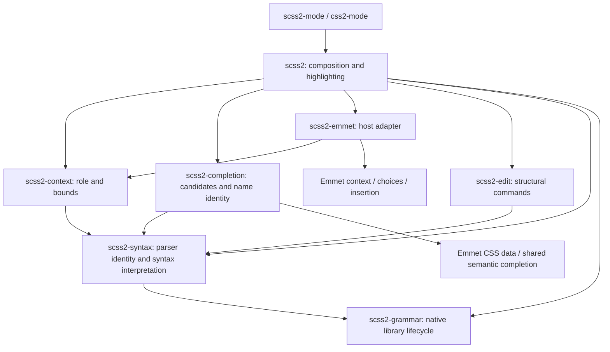

# Architecture

The document is an Emacs buffer. Tree-sitter, lexical syntax, completion and
structural targets are readings of that buffer, not independently synchronized
models. The only persistent derived artifact is a native parser library keyed by
the bundled parser sources (`src/`) and platform.

## Dependencies and responsibilities



| Library | Responsibility and interface | State / excluded dependencies |
| --- | --- | --- |
| `scss2-grammar` | `scss2-grammar-ensure` loads a private dialect identity; compilation and disk cache | Owns native-source/platform identity, native artifacts and load verification; no editor feature dependencies |
| `scss2-syntax` | `scss2-syntax-lexical-setup` installs syntax table, comments and indentation without a parser; `scss2-syntax-setup` initializes the parser and syntax properties; shared node/identity/range readers | Owns buffer dialect, loaded language and session-compiled internal queries; no completion, editing, host or Emmet dependency |
| `scss2-context` | `scss2-context-at-point` returns role, bounds and role-specific facts | Request-local reads only; no catalog, module I/O, host or Emmet dependency |
| `scss2-completion` | `scss2-completion-for-context` consumes explicit context plus the current parsed buffer; supplies candidates and name identity to `emmet2-completion-capf` | Tables are session-local; no classifier, host mode or Emmet adapter dependency |
| `scss2-edit` | Public structural commands and syntax-based TAB navigation | Targets live for one command; no context, completion or required frontend dependency |
| `scss2-emmet` | Context provider, explicit expansion and abbreviation CAPF | One synchronous context binding; emmet2-mode owns live choices, revisions and insertion, which adds no snippet fields to CSS |
| `scss2` | `scss2-completion-at-point` selects the provider; mode setup, font lock and navigation | Composition owns hook registration; semantic libraries never call back into it |

Root Lisp files are Emacs load-path libraries. Their separation follows these
responsibilities; a directory hierarchy or another runtime wrapper layer would
not create a stronger boundary. `vendor/` is an indivisible generated snapshot;
`scripts/` contains build/test/measurement entry points; `test/` contains subsystem
contracts and full-mode integration. There are no runtime dependencies on `test/`
or `docs/`.

The parser's [statements-being-typed
contract](https://github.com/P233/tree-sitter-scss#consumer-contract) usually
keeps later rules intact; inside the error neither tree shape nor colors are
guaranteed. Context falls back to statement text for completion there, while
structural editing rejects ambiguous tree ranges, so the unfinished construct
itself is not editable until it is repaired. Integration tests check that the
block after an unfinished statement stays editable with undo/redo, and that
repair restores editing and the same face spans as a fresh buffer.

The two major modes, the `scss2-completion-at-point` autoload, the `scss2`
completion category and the structural commands that the README describes are
the stable public interface. Other code uses the interfaces above; private `--`
helpers belong to their library.

For a new feature, first identify its owner and behavioral contract, then change
the owning subsystem and add acceptance coverage. Changes to syntax
interpretation shared by features belong in `scss2-syntax`; new candidate
catalogs belong to their existing data owner. Benchmark hot-path changes. Add
state or another layer only when it removes a demonstrated obligation that
direct derivation cannot.

## Initialization and lifetime

1. Enter `prog-mode`, then `scss2-syntax-lexical-setup` installs the dialect's
   syntax table, comment syntax, indentation and syntax-propertize function;
   none needs a parser, and the function reads the tree only once one exists.
   Emacs clears the previous major mode's local state/parsers.
2. `scss2-syntax-setup` selects the dialect and private grammar generation, creates
   its parser with a change notifier (see
   [Changed ranges of early reparses](#changed-ranges-of-early-reparses)) and
   extends syntax propertization back to the ranges a reparse changed.
3. Full mode composition adds Emmet, highlighting, navigation and the CAPF hook,
   then makes treesit.el's tree hooks and commands read Font Lock's view (see
   [Narrowing and the shared parser](#narrowing-and-the-shared-parser)).
   A syntax-only client can stop after step 2.

Like built-in Tree-sitter modes, full mode composition checks readiness before
step 2. A buffer larger than `treesit-max-buffer-size` gets the standard
`treesit` warning; a grammar that cannot be built or loaded (no C compiler, an
Emacs without Tree-sitter, an unwritable cache) gets an `scss2` warning with the
build error. Either way the buffer skips steps 2-3, keeps step 1's lexical
editing and syntactic highlighting of comments and strings with `scss2-dialect`
nil, and still runs its mode hooks, so globalized minor modes such as Font Lock
turn on. `scss2-syntax-setup` makes neither check and signals; syntax-only
clients own that policy. A missing emmet2-mode host API still signals: it means
a mismatched source installation, not an environment to degrade in.

The grammar cache rejects empty or missing compiler output before publishing it
and rebuilds an existing empty library. Its identity hashes the vendored files
under `src/`, so a query or fixture update reuses the built library. `CC` is
split like a shell command, and the compiler runs in the cache directory.

Keymaps are shared by every buffer of a mode, so buffer state must not be
written into them unconditionally. `treesit-major-mode-setup` does exactly that:
it remaps `beginning-of-defun` and `end-of-defun` in the mode map, and a larger
buffer opened before or after a parsed one would then run Tree-sitter motion
without a parser, leaving point in place. `scss2--scope-tree-remaps` turns each
remap into a `menu-item` whose filter, `scss2--tree-binding`, returns the
command only where `treesit-primary-parser` is set. Only
`treesit-major-mode-setup` sets it, so oversized buffers and buffers whose setup
failed are excluded. Elsewhere the filter returns the parent keymaps' remap,
because a nil result would shadow remaps in `prog-mode-map`; a larger buffer
keeps `prog-mode`'s `C-M-a` and `C-M-e`. Help listings that render keymaps in a
temporary buffer, such as `C-h m` and `\{scss2-mode-map}`, therefore omit the
scoped remaps; `C-h b` and `C-h f` in a parsed buffer still show them. The remap
scoping is INTERIM until treesit.el stops writing these remaps into the shared
mode map; it is separate from the narrowing wrappers and outlives them. To check
whether a newer Emacs still needs it, delete the `scss2--scope-tree-remaps` call
in a scratch copy: `scss2-mode-oversized-buffers-keep-base-defun-motion` fails
while `treesit-major-mode-setup` still writes the remaps. If treesit.el stops
remapping instead, `scss2-mode-parsed-buffers-remap-defun-motion` must expect
`beginning-of-defun` and `end-of-defun`.

The shared query owns semantic capture roles; the host owns their faces.
Selector prefixes inherit the selector role. With `scss2-fontify-details`,
numbers and nth formulas use the standard number face; without it they stay
plain. Units always use the type face, and expression operators use the constant
face, as plain values do. The `number` and `unit` nodes and their ranges stay
separate in the parser, independent of color, for syntax consumers and numeric
editing. Selectors and properties use `scss2-selector` and `scss2-property`,
which inherit the function-name and keyword faces as css-mode's selector and
property faces do. The remaining roles use standard Font Lock faces, so themes
own the palette without a mode-specific color scheme or theme dependency.

The buffer's grammar identity stays fixed even if loading a newer package changes
the global snapshot identity. Features read that buffer identity. Compiled
internal queries are session data keyed by that immutable identity and the query
form. Every grammar request loads its native library to verify it. Local
module completion reuses a matching parser in an open buffer, including unsaved
edits; otherwise it parses that authoritative text, or a disk file, in a
temporary buffer. Temporary parsers die with their buffers. There is no module
index.

`scss2-syntax` owns one idle timer that releases trees and fontification from
invisible buffers. It retains each parser's identity: an empty parse frees the
native tree, then restoring the original full-buffer range marks it for lazy
reparsing through every native consumer. No suspended-buffer registry or
feature-specific resume path is needed. Font Lock invalidation and
unfontification remove its managed properties; equal remaining property runs are
coalesced without removing syntax or third-party properties. Text, narrowing,
point, modification state and undo remain unchanged. The timer yields between
buffers when input is pending and stops when no syntax clients remain.

Visible buffers in all frames, active completion sessions, and indirect buffers
and their bases are excluded. Parsers with custom ranges, other packages'
notifiers, or additional parsers also remain untouched because they have other
lifecycle owners; the mode's own change notifier does not count. Cleanup does
not force GC; freed allocations can remain resident in Emacs's allocator.

### Lexical editing without css-mode

The modes derive from `prog-mode` and declare `css-mode` and `css-base-mode`,
plus `scss-mode` for `scss2-mode`, as extra parents with
`derived-mode-add-parents`, as `css-ts-mode` does for `css-mode`.
`derived-mode-p`, directory-local variables and emmet2-mode's CSS host checks
therefore treat them as CSS buffers without loading css-mode; those modes' hooks
and keymaps do not apply. css-mode pulls in eww, shr, sgml-mode and SMIE; with
it, requiring the package takes about five times as long (130 ms against 25 ms
in `emacs -Q`) and adds 3 MB of live heap. emmet2-mode at the commit pinned in
CI does not load it either, including for embedded styles and CSS completion
previews; a fresh-process test checks that opening a stylesheet and completing a
value does not load it.

Indentation reads bracket depth from `syntax-ppss`, so it works without a parser,
as in a clone or after a grammar failure. Inside a bracket, a statement follows
the previous statement line of the block, or else nests `scss2-indent-offset`
from the line that starts the bracket's statement; a closer returns to that
line. With a parser, a line that continues a statement indents once more from
the statement, or from the first line of the selector it continues, and later
continuation lines follow the previous one; the next selector of a list, an
`@else` branch and a lone `{` align with the statement. A blank line after a
trailing `,` or `:` continues that declaration. A line that starts with `*` in
a block comment aligns under the opener's star; other comment and string lines
keep their indentation. Reindenting a 335-file local corpus at each file's own
width changes 3 of 35,168 nonblank lines (nested space-separated continuations
that Prettier indents further), against 65 with css-mode's SMIE rules.

Comment filling adapts the comment branch of css-mode's `css-fill-paragraph`
and its adaptive fill prefix. Filling in code changes nothing; css-mode
reformats the declaration block there. EditorConfig's `indent_size` sets
`scss2-indent-offset`; `css-indent-offset` is not read. css-mode's color format
cycling and MDN lookup are not provided.

With `scss2-fontify-colors`, a last font-lock rule shows hex colors, CSS color
names (from `shr-color`) and `rgb()`, `rgba()`, `hsl()` and `hsla()` calls with
literal components on their own color, as css-mode's `css-fontify-colors` does;
it marks the same spans as css-mode over the corpus, in less time than
css-mode's regexp pass.

## Completion flow

`scss2-context-at-point` first excludes opaque comments and strings, then
applies one ordered classifier. Recognized literals, names, selectors, queries
and declarations precede text recovery for unfinished statements, which also
covers loop ranges, variable values and loop bindings. Order is language
behavior. A recovered tree shape decides a role only when it confirms
that role. Without auto-pairing an unclosed `(` is the ordinary typing state,
and recovery can attach the next statement's tokens to it, so the classifier
reads the colon after a declaration name from the text, accepts an unqualified
`var(` first argument from the text, defers an unclosed group in a query
statement to the `@media`/`@container`/`@supports` statement-text recovery, and
treats a Sass statement starting with `$` as a variable declaration even outside
a block. The result contains accessible replacement bounds, a role and only the
facts consumers need (`:property`, `:at-rule`, `:owner`, `:module`, `:mixin`,
`:query`, `:start`). No intermediate rule object or context cache is retained.
In Sass, `:property` is the compiled name of a property declaration inside
nested property blocks, such as `font-weight` for `weight` in `font: { … }`,
also through control-flow and content blocks between them. Those blocks also
keep the enclosing descriptor domain in `:at-rule`, such as `@font-face`. A name
slot there has no `:start`, because Emmet expansions write whole names that Sass
would prefix again.

A declaration prefix followed by a blank line and a nested selector can be
parsed as one valid multiline selector. In a declaration body, completion treats
that isolated, unqualified token as an insertion slot. The same preference
applies when the token occupies a new line after a semicolon-terminated
declaration, even without an extra blank line before the nested rule. Comments
between statements do not change this decision. This is an editing preference
for ambiguous bare words, derived from sibling nodes rather than remembered
typing state or a property catalog. Explicit selector prefixes, pseudo chains
and leading combinators on the following line retain their selector role, as
do adjacent selector lines without that preceding declaration. The syntax tree
and highlighting are unchanged. A declaration prefix may contain bracket raw
values with blanks, such as `p[1px 2px]`, and Sass variables glued to the
abbreviation, such as `p$a$b$c`. A bracket group with `=` before any
string, call or nested bracket keeps the selector role (`a[title='x']`),
because attribute selectors put their operator first. Strings, calls and
nested brackets balance inside the group, so `=` or `]` there stays part of a
raw value, as in `bgi[url(a.png?x=1)]`, `ct[']']` or `gtc[repeat(2, [a] 1fr)]`.

Composition routes declaration prefixes to Emmet and other supported roles to
semantic completion. Semantic tables are exclusive: other completion functions
do not run in an owned context, even without a match. A module without a local
file (`sass:math`, packages, load paths) and an import path with a scheme or
without a local directory return nil instead, leaving them to later functions
such as a language server. Only resolving the module and checking its file is
eager: frontends such as Corfu call the dispatcher again on every key, so
members are collected on the first candidate query. Deciding that a local module
which only `@forward`s has no names would parse it on each key, so it stays
exclusive. Emmet's table keeps emmet2-mode's own `:exclusive 'no`; every
candidate is the abbreviation itself, so it wins whenever it has choices and
yields when an admitted word has none. The adapter's dynamic context binding
only avoids analyzing the same synchronous request twice. It is never captured
by a table; later Emmet requests use current source and revision checks.

Semantic tables obey Emacs's literal completion-table protocol. The `scss2`
style uses emmet2-mode's shared matcher with the host's escape/Sass identity
function, leaving original insertion spellings intact. Function acceptance with
status `finished` only places point inside empty parentheses; no value
completion creates snippet fields. Common annotation text is derived once per
table; display callbacks read that same immutable table context. Frontends own
timing and drawing. emmet2-mode owns its own table, render options, preview,
stale-candidate validation and atomic insertion transaction. It inserts CSS
results without snippet fields, keeping canonical results and initial cursor
positions.

Before a nonempty line's first nonblank character, TAB uses the mode's
indentation function and moves to that character. A shared predicate gives this
action the same priority during key lookup and execution; blank lines and active
regions keep their existing behavior. At the first character or later, TAB uses
the current parsed declaration to jump from its name to its value's first node,
and from its value directly past its semicolon, including from nested calls and
snippet fields. A Sass map key resolves its nearest map entry instead of the
enclosing declaration, so multiline and nested maps follow the same sequence:
leading whitespace, key, value. From a map value, declaration navigation is
unchanged. Name/key-to-value navigation first reindents the current line unless
a region is active or the line's beginning is inaccessible. Correct indentation
does not modify text. The destination resolver stays read-only for key lookup;
the command dismisses completion previews before indenting and resolves the
destination again after indentation changes positions. Other snippet navigation
keys keep their own behavior; outside these indentation and declaration targets,
TAB keeps its existing binding.

## Structural mutation and history

Commands derive a target from the current tree, validate its accessible range and
recovery boundary, then execute through `scss2--transaction`. Emacs's atomic change
group owns text history. The transaction also restores point, mark, activation and
kill-ring state when an operation signals an error or quit. No syntax node or
position is cached across edits. Clipboard callbacks run inside the transaction;
buffer switches do not transfer ownership of the edit or its rollback.

Completion tolerates unfinished code; that does not authorize destructive edits
through uncertain ranges. These policies have separate acceptance tests, including
an integration contract exercising both on the same unclosed callable.

### Structural targets

Kill, copy, duplicate, mark and comment resolve their target through one entity
resolver, `scss2--resolve-target`. It ascends from the containing node to the
nearest type in `scss2-entity-node-types`, including through whitespace in
values. Three rules precede the option: a selector selects its owning rule,
inter-statement body whitespace selects the nearest complete structural block,
and an existing comment selects its comment group. Selector branches, value
atoms, arguments and parameters are not entities, and an else branch's entity is
the complete conditional chain. Prefix arguments are ignored; point determines
the target for every structural command. TAB's declaration lookup, Empty's
content ranges and Avy's navigation container have their own resolvers.

Only kill selects an `@if` or `@else if` condition separately: the entire
condition after the directive and before the opening brace, with bounds from the
shared value-range helper `scss2--value-bounds`, which keeps the whole
`@else if` prefix. A nearer map entry or comment still selects itself. On the
directive or opening brace, kill selects the complete conditional chain. All
other at-rule headers select the complete statement or block, including function
and mixin names and parameters.

Entity and content selection share `scss2--entry-at-point`: an entry's end and
its trailing whitespace before a direct comma or closing parenthesis belong to
that entry. It checks the entry's parent and adjacent delimiter, without
crossing comments or passed commas. Completed nested values select their outer
entry; positions inside those values keep the nearer content target. Map targets
record their direct comma neighbors and use the map as their validation owner.
Kill reuses the comment-preserving separator deletion ranges; the last entry
leaves `()`, except that an empty `@at-root` query also loses its parentheses.
Comment spans those deletion ranges, including the required commas or query
parentheses, with separator whitespace outside its markers.

Empty walks ancestors on its own for bracket, interpolation and string
interiors, declaration and map entry values, named argument values, parameter
defaults and block bodies. Map entries, `named_argument` and `parameter` nodes
share the colon-to-value-end range; a parameter without a default keeps walking
upward. Selection starts from the shared entry-tail target when present and
otherwise from the containing node; nested interiors stay nearer targets while
point is inside them. There is no per-at-rule dispatch. A statement's `name` or
`module` field selects its direct `arguments` or `parameters` container, which
its directive also uses when the statement has no body. Inside a header, nearer
interiors win, and a bare condition continues to its statement's body. Direct
delimiter pairs are matched around point, including headers such as `@scope`
with several parentheses and no separate container nodes. Each conditional
branch keeps its own body.

Without a nearer interior or body, a leaf at-rule uses the shared nonempty head
range, keeping its directive and semicolon. Leaf at-rules without content
continue to their enclosing block, and comments stop the search. A header
interior with its own node is validated by that node, so unrelated body errors
do not invalidate its range; a leaf statement remains the validation owner of
its interiors. Directly inside interpolation, a function name selects the
interpolation. Clearing a required value intentionally leaves incomplete syntax,
as does killing a required condition.

Kill, copy, duplicate, mark and uncomment share one comment range: consecutive
standalone `//` lines form a group, which blank lines end, and block and
trailing comments stand alone. No previous-operation state is stored, and
grouping also restores a handwritten `//` note adjacent to commented code.
Commenting delegates to Emacs's `comment-region` and `uncomment-region`, using
`indent` for line comments and `multi-line` for block comments. Block comments
serve inline targets and CSS; standalone SCSS lines use line comments. When a
block is commented, its blank lines also receive `//`, so a normal uncomment
restores the whole block. Line-comment ranges include the first line's
indentation and the final CR in literal CRLF text. Native region alignment
places all `//` markers at the minimum indentation. Emacs's comment machinery
also quotes and restores nested block comment delimiters. Duplicate preserves
body text and CRLF and adds no statement separator to comments; even a trailing
`//` copy gets its own line. Repeated mark keeps its existing selection.

Avy is loaded only by its command. Its own ancestor walk selects the nearest
complete multiline container: a rule, at-rule or nested property block, map,
list or module configuration. Argument and parameter lists continue upward to a
qualifying container, as do single-line containers; ordinary declarations, map
entries, strings, comments and raw value groups never become navigation scopes.
Direct delimiter checks establish complete boundaries, and an else branch
selects its whole conditional. A closing delimiter belongs to its container;
point after it belongs to the parent, including between map entries. The entire
container, including its header or delimiters, is passed unchanged to Avy, with
both Avy window settings and the prefix argument locally disabled so that no
other buffer receives the same numeric range.

## Invariants and independent tests

- One document authority: buffer text, with Emacs-owned undo and incremental parse.
- One buffer syntax identity; no second parser for highlighting or completion.
- Every scss2 tree reader reads Font Lock's view: the widened buffer unless
  `font-lock-dont-widen` is set. That covers tree hooks, syntax properties,
  treesit.el commands, context, completion candidates, Emmet extraction and
  structural targets. Commands then act only inside the caller's restriction.
  Hooks that Emacs runs on its own read the tree only when the buffer has its
  own scss2 parser; otherwise, as in a `clone-indirect-buffer` clone, they keep
  lexical editing: syntax, comments and bracket-based indentation.
- Every reparse after a text change marks the ranges it changed for
  refontification and extends the next syntax propertization back to them
  within that caller's restriction, whichever reader caused it; idle release's
  own reparses mark nothing.
- One completion dispatcher; lower libraries cannot load host composition.
- Context does not enumerate candidates or resolve module files.
- Semantic tables do not classify point or call the abbreviation adapter.
- Open-buffer module text wins over disk; loaded grammar generation is preserved.
- Targets and context are transient; no workers or synchronization. The only
  session cache is compiled internal queries.

```sh
make test-core
SCSS2_EMMET2_DIR=/path/to/emmet2-mode make test-semantic
SCSS2_EMMET2_DIR=/path/to/emmet2-mode make check
```

`test-core` runs grammar, context and structural editing with real parsers in a
fresh Emacs process, without an Emmet load path. `test-semantic` needs only Emmet's
data/matching libraries. The runner rejects indirect loads of forbidden higher
layers, so independence is a tested boundary. The shared test fixture initializes
real syntax rather than mocking tree nodes or the context API.

`make check` also runs strict byte compilation, Python packaging/import tests,
the complete source ERT suite and isolated package-installation ERT. Full-mode
tests cover navigation, faces, hooks, dialect lifecycle, Emmet and cross-feature
contracts. The Corfu/YAS suite (`make test-frontends`, run in CI) exercises
typing, choosing, host TAB and undo; it stubs drawing and is not GUI acceptance.
Release packaging requires a clean parser manifest. CI checks out the
emmet2-mode commit pinned in `.github/workflows/check.yml`.

## Performance model

Tree-sitter owns incremental parsing. Classification traverses relevant
ancestors and current-statement text, and large sibling groups may require
linear scans. Definition enumeration is proportional to tree size plus scope
checks. Module exports and matching must inspect the offered symbol set; no O(1)
large-project claim is made. Path completion lists one local directory per
request. Module completion resolves the namespace's `@use` and checks that its
file exists on every request; that reads every `@use` in the tree, about 1.4 ms
more per key on `examples/highlight-stress.scss` (72 KB) and 17 ms on its
tenfold repetition (724 KB, byte-compiled, batch). It enumerates and parses the
module only when its members are queried.

Highlighter rules are built during mode setup. JIT invalidation and
fontification remain Emacs-owned. Existing batch workloads cover 0/1,000
declarations, open modules with 100/1,000/5,000 symbols, the 72 KB stress
fixture and its 724 KB tenfold repetition, 512 nested query levels, 4,096 query
comments and a numbers-heavy document.

Internal query compilation loads the native language, so it runs once per
session rather than per buffer. Grammar verification loads the library on every
request. The library ends in `.so` (`.dll` on Windows) and is registered for the
first file Emacs tries: relative to `user-emacs-directory`'s `tree-sitter/`, or
absolute when `treesit-extra-load-path` is set, so a load takes about 0.1 ms.
Emmet's CSS documentation data loads on the first semantic completion that needs
it.

Compare byte-compiled copies with the same parser, Emmet, inputs and GC
settings. Candidate counts, parser counts and face hashes must agree before
timing is compared. A repeatable material regression requires investigation; a
cache is not the default remedy. `scripts/benchmark-emacs.el` measures mode
setup, parsing and full and incremental fontification per workload; compare
separate processes on the same fixtures. Each workload runs with
`scss2-fontify-details` off and on; compare face hashes only within one setting.

## Narrowing and the shared parser

Emacs's Tree-sitter parsers follow narrowing. Any read of the tree inside a
restriction (`treesit-buffer-root-node`, `treesit-node-at`,
`treesit-parser-changed-regions`) first moves the parser to the accessible text;
the next read in the widened buffer must reparse everything outside it again.
Font Lock widens before fontifying unless `font-lock-dont-widen` is set, so a
reader that uses another view than Font Lock flips the parser between the two.

The symptom is keystroke cost proportional to the buffer size, only while the
buffer is narrowed. Commands that narrow internally, such as `uncomment-region`,
`comment-dwim` (`M-;`) and comment toggles like evil-nerd-commenter, cause the
same cost in a widened buffer. In Emacs 31.1 two treesit.el hooks read inside
the restriction on every change, so each edit pays a restricted parse and then
a near-full reparse. Batch measurements of byte-compiled copies with an emulated
command loop and redisplay:

| Case | Stock hooks | Widened hooks |
| --- | --- | --- |
| 729 KB stylesheet narrowed to 5.7 KB, per key | 57-59 ms, 2 parses | 3.5-4.0 ms, 1 parse |
| The same buffer widened, per key | 3.5-3.7 ms | 3.5-3.7 ms |
| `uncomment-region` of one line, widened 729 KB buffer | 54-57 ms | 3.6-4.1 ms |
| 27 KB stylesheet narrowed to 2.5 KB, per key | 4.2-4.3 ms | 0.20-0.21 ms |

scss2 therefore replaces two private treesit.el functions that
`treesit-major-mode-setup` adds to buffer-local hooks:

| Hook | treesit.el function | scss2 wrapper |
| --- | --- | --- |
| `pre-redisplay-functions` | `treesit--pre-redisplay` | `scss2--pre-redisplay` |
| `syntax-propertize-extend-region-functions` | `treesit--pre-syntax-ppss` | `scss2--pre-syntax-ppss` |

`scss2--setup` in `scss2.el` calls `scss2--widen-tree-hooks` right after
`treesit-major-mode-setup`. For each pair in `scss2--widened-tree-hooks` it
removes the treesit.el function from the buffer-local hook and adds the wrapper
at depth 0, where treesit.el added it. Each wrapper calls the treesit.el
function inside `scss2--with-font-lock-view` (`scss2-syntax.el`): a
`save-restriction` that widens unless `font-lock-dont-widen` is set. Redisplay
rechecks the restriction after these hooks, so restoring it unchanged costs no
redisplay optimization.

Some hosts fontify only the restriction. Polymode sets `font-lock-dont-widen` in
its buffers, and markdown-ts-mode binds it while fontifying a code block in an
indirect buffer narrowed to the block. There the restriction is the document,
so the wrappers read inside it, as the stock hooks and Font Lock do. Widening
would parse the host text as stylesheet code on each change, and host text such
as `/*` before the restriction could turn the stylesheet into a comment.

`treesit--pre-syntax-ppss` can extend the propertized region back to the first
position the last reparse changed. In the full tree that position can precede
the caller's restriction, for example after closing a comment opened above it.
`syntax-propertize` would then clear properties from there and signal
`args-out-of-range`. `scss2--pre-syntax-ppss` clamps the start to the caller's
`point-min`, the bound the stock function applies inside a restriction; text
before the restriction keeps its previous syntax properties, as with the stock
hook.

`scss2--syntax-propertize` also queries the tree in Font Lock's view, so syntax
properties come from the parse that Font Lock uses. So do the package's other
tree readers: context, completion candidates, Emmet's abbreviation extraction
and structural commands, including whole-line deletion and comment grouping,
resolve in Font Lock's view and then enforce the
accessible range. In a `font-lock-dont-widen` host the restriction is the
document, so completion and commands parse only the restriction, as redisplay
does, and host text is never parsed as stylesheet code. Imenu and idle release
widen before reading; local module completion reads other buffers widened.

If either treesit.el function is undefined or missing from its hook,
`scss2--widen-tree-hooks` leaves that hook unchanged. Editing then keeps Emacs's
stock behavior, and only the narrowed keystroke cost returns. Strict byte
compilation in `make check` reports a removed function as not known to be
defined.

### Tree-sitter commands

`treesit-major-mode-setup` also points public variables and mode-map remaps at
treesit.el commands that read the tree inside the caller's restriction. In a
narrowed buffer each invocation then costs a restricted parse plus a full
reparse at the next widened read, and the restricted parse can be wrong: a
restriction inside a block parses as top-level declarations, so `M-q` reports
"No defun detected at point". Right after setup, `scss2--widen-tree-commands`
points every variable and remap that still holds its treesit.el original at a
wrapper in `scss2.el`:

| Variable or remap | Used by | treesit.el function | scss2 wrapper |
| --- | --- | --- | --- |
| `<remap> <beginning-of-defun>`, `beginning-of-defun-function` | `C-M-a`, `beginning-of-defun` | `treesit-beginning-of-defun` | `scss2--beginning-of-defun` |
| `<remap> <end-of-defun>`, `end-of-defun-function` | `C-M-e`, `end-of-defun`, `mark-defun` | `treesit-end-of-defun` | `scss2--end-of-defun` |
| `prog-fill-reindent-defun-function` | `M-q` | `treesit-fill-reindent-defun` | `scss2--fill-reindent-defun` |
| `transpose-sexps-function` | `C-M-t` | `treesit-transpose-sexps` | `scss2--transpose-sexps` |
| `add-log-current-defun-function` | `which-function-mode`, `C-x 4 a` | `treesit-add-log-current-defun` | `scss2--add-log-current-defun` |
| `outline-search-function`, `outline-level` | `outline-minor-mode` | `treesit-outline-search`, `treesit-outline-level` | `scss2--outline-search`, `scss2--outline-level` |

Each wrapper finds its target in Font Lock's view, like the hooks above, and
then acts only inside the caller's restriction:

- `C-M-a`, `C-M-e` and `beginning-of-defun` move as in the widened buffer when
  the target is accessible. Otherwise point stops at the restriction's nearer
  edge and the function returns nil, as regexp-based defun motion does at a
  restriction edge. lisp.el's `end-of-defun` and `mark-defun` (`C-M-h`, not
  remapped) start with `beginning-of-defun-raw`, so when the defun around point
  begins before the restriction they work from the restriction edge and can
  move to or mark the following defun, as with regexp-based defun motion and
  the treesit.el commands.
- `M-q` chooses between filling and reindenting in Font Lock's view, with
  prog-mode's private `prog--text-at-point-p`, the predicate that
  `treesit-fill-reindent-defun` uses. A restriction that starts inside a
  comment hides the comment's opener: an apostrophe after it then reads as a
  string over the code below, and the stock command filled that code into the
  comment line. Filling runs through `treesit-fill-reindent-defun` inside the
  restriction only when the restriction reads the same comment or string;
  otherwise `M-q` signals a user error. Reindenting takes the innermost defun
  from the full tree and reindents its lines whose indentation is accessible.
  `indent-region` widens to compute indentation, so an accessible line gets the
  indentation the widened buffer gives it with the current text outside the
  restriction. A line that begins before the restriction or whose indentation
  crosses its end keeps its indentation.
- `transpose-sexps` takes both sexps from the full tree and signals a user error
  without editing when either extends outside the restriction.
- `add-log-current-defun` and `outline-level` only read the tree and return the
  full tree's answer.
- Outline search finds headings in the full tree but accepts only a heading line
  that begins inside the restriction. Otherwise it fails like a regexp search,
  stopping at the edge when asked to move.

Imenu needs no wrapper: `imenu--make-index-alist` widens before reading. With
an accessible target, results equal the widened buffer's, except for lisp.el's
`end-of-defun` and `mark-defun` as described above; without narrowing they
equal the treesit.el commands'. On a real 19 KB stylesheet narrowed to 30
lines around each sampled line, stock `M-q` reported "No defun detected at
point" for 31 of 104 restrictions and the wrappers for none whose restriction
contains point. Measured with the batch harness described above, per
invocation including the redisplay that follows:

| Case | treesit.el commands | Wrappers |
| --- | --- | --- |
| `C-M-a`, 729 KB stylesheet narrowed to 5.7 KB | 58.8-60.6 ms, 2 parses | 0.19-0.21 ms, no parse |
| `M-q`, then the next key, same buffer | 12.9-13.9 ms + 48.7-50.7 ms | 0.51-0.53 ms + 3.7-4.7 ms |
| `add-log-current-defun`, same buffer | 11.0-12.0 ms, 1 parse | 0.03-0.04 ms, no parse |
| `C-M-a`, 27 KB stylesheet narrowed to 2.5 KB | 0.94-0.99 ms, 1 parse | 0.06-0.07 ms, no parse |
| `M-q`, then the next key, same buffer | 1.28-1.37 ms + 3.71-3.92 ms | 0.18-0.20 ms + 0.25-0.32 ms |

Widened, the wrappers and the treesit.el commands cost the same. A variable or
remap that no longer holds its treesit.el original, because treesit.el or
another package changed it, stays unchanged and keeps that behavior. Strict
byte compilation reports a removed treesit.el command or
`prog--text-at-point-p` as not known to be defined.

### Tests and diagnosis

`test/scss2-narrowing-test.el` guards this behavior:

- `scss2-narrowing-typing-parses-once-per-key`: typing in a narrowed buffer, in
  both hook orders, parses once per key and never while narrowed; faces and
  syntax properties then equal a new unnarrowed buffer's.
- `scss2-narrowing-font-lock-dont-widen-reads-the-restriction`: with
  `font-lock-dont-widen`, typing parses only the restriction, once per key, and
  a narrowed code block after host text containing `/*`, an apostrophe or plain
  markup gets one restricted parse, the block's own syntax properties and
  context, and `scss2-mark` and `scss2-kill` targets inside it.
- `scss2-narrowing-incomplete-comment-ranges-reject-uncomment`: a comment
  whose delimiters extend outside the restriction cannot be uncommented.
- `scss2-narrowing-comment-commands-never-parse-the-restriction`:
  `comment-region` and `uncomment-region` in narrowed and widened buffers.
- `scss2-narrowing-features-read-the-full-tree`: context, completion,
  `scss2-mark`, `scss2-kill` of a declaration and Imenu.
- `scss2-narrowing-syntax-extension-stays-accessible`: the clamp, also after an
  earlier reparse, without `syntax-propertize` complaining about the narrowing.
- `scss2-narrowing-wrappers-replace-only-present-treesit-hooks`: installation and
  the fallback for renamed or removed functions.
- `scss2-narrowing-tree-commands-match-the-widened-buffer`: at every line of
  nested SCSS, with restriction edges at line starts and inside lines, each
  command matches the widened buffer when its target is accessible, and
  otherwise stops at an edge or refuses without editing. Widened, it matches
  the treesit.el command.
- `scss2-narrowing-tree-commands-parse-once`: after an edit, each command and
  the redisplay that follows parse once, plus once more when the command itself
  edits text (as `transpose-sexps` does), never in the restriction.
- `scss2-narrowing-fill-reindent-defun-in-a-cut-block`: `M-q` in a restriction
  inside a block, including lines whose indentation begins before or crosses it.
- `scss2-narrowing-fill-reindent-defun-decides-in-the-full-buffer`: `M-q` below
  or inside a comment whose opener lies before the restriction.
- `scss2-narrowing-outline-search-finds-only-accessible-headings` and
  `scss2-narrowing-outline-level-reads-the-full-tree`.
- `scss2-narrowing-tree-command-wrappers-replace-only-treesit-originals`:
  installation and the fallback for changed variables.

To diagnose slow narrowed editing:

1. Run `SCSS2_EMMET2_DIR=/path/to/emmet2-mode SCSS2_TEST_SELECTOR=scss2-narrowing make test`.
2. In the slow buffer, evaluate
   `(list pre-redisplay-functions syntax-propertize-extend-region-functions)`.
   It must show the `scss2--` wrappers, not the `treesit--` functions. Otherwise
   check whether treesit.el still defines both functions and adds them in
   `treesit-major-mode-setup`, then update `scss2--widened-tree-hooks`. For a
   slow command, evaluate the variables in `scss2--widened-tree-functions`; each
   must hold its `scss2--` wrapper, or `scss2--widened-tree-functions` and
   `scss2--widened-tree-remaps` need updating.
3. Compare per-key time narrowed and widened, for example with
   `profiler-start`. To find a reader that parses the restriction, attach a
   notifier that records a backtrace for each narrowed parse, then remove it
   with `treesit-parser-remove-notifier`; idle release skips the buffer while a
   notifier is attached. Where `font-lock-dont-widen` is set, every parse is
   narrowed by design; look for widened parses there instead:

   ```elisp
   (defun my-scss2-narrowed-parse (_ranges parser)
     (with-current-buffer (treesit-parser-buffer parser)
       (when (buffer-narrowed-p)
         (let ((standard-output (get-buffer-create "*scss2 narrowed parses*")))
           (backtrace)))))
   (treesit-parser-add-notifier (car (treesit-parser-list)) #'my-scss2-narrowed-parse)
   ```

The root cause is in treesit.el: its redisplay and syntax-propertize hooks and
its commands read the tree inside the caller's restriction instead of Font
Lock's view. Reading in Font Lock's view, or parsers that do not follow
narrowing, would remove both the hook and command wrappers. With long lines,
Emacs fontifies inside a labeled restriction that `widen` cannot lift;
Tree-sitter Font Lock still reparses inside it there, and these wrappers do not
help. The wrappers are therefore marked INTERIM in
`scss2.el`.

A fix for tree reads alone does not fix `M-q`. `treesit-fill-reindent-defun`
chooses between filling and reindenting with `prog--text-at-point-p`, which
calls `syntax-ppss` in the caller's restriction before reading the tree. The
`M-q` decision therefore needs its own fix in prog-mode or treesit.el, and
`scss2--fill-reindent-defun` has its own INTERIM marker. Its exit check is
`scss2-narrowing-fill-reindent-defun-decides-in-the-full-buffer`.

To check whether a newer Emacs still needs the hook wrappers, delete the
`scss2--widen-tree-hooks` call in a scratch copy and run the narrowing tests
from step 1. In Emacs 31.1 the typing, comment command, feature and command
parse tests fail, as does
`scss2-narrowing-wrappers-replace-only-present-treesit-hooks`. Once only that
installation test fails, remove the two wrappers, `scss2--widened-tree-hooks`,
`scss2--widen-tree-hooks` and that test. For the command wrappers, delete the
`scss2--widen-tree-commands` call instead; in Emacs 31.1 seven narrowing tests
fail. Once only
`scss2-narrowing-tree-command-wrappers-replace-only-treesit-originals` fails,
remove the wrappers, `scss2--widened-tree-functions`,
`scss2--widened-tree-remaps`, `scss2--widen-tree-commands` and that test, and
change the commands that `scss2-mode-parsed-buffers-remap-defun-motion` expects
to `treesit-beginning-of-defun` and `treesit-end-of-defun`.
Keep `scss2--scope-tree-remaps`: it then scopes treesit.el's own commands (see
[Initialization and lifetime](#initialization-and-lifetime)).

## Changed ranges of early reparses

`treesit_ensure_parsed` computes the ranges that each reparse changed and passes
them to the parser's notifiers, but `treesit-parser-changed-regions` returns
them only to the caller that triggered the reparse. In Emacs 31.1 only
`treesit--pre-redisplay` marks those ranges for Font Lock and syntax
propertization, and only when its own call reparses. When completion,
`treesit-inspect-mode` or other code reads the tree between an edit and
redisplay, nothing marks them. Text whose parse changed outside the edited line
then keeps stale faces, for example a `@mixin` name once its parameter list
becomes valid, or the rules after a block comment is closed. jit-lock's
contextual refontification starts at the edited line, so it cannot repair text
before it.

`scss2-syntax-setup` adds `scss2--mark-changed-ranges` as a notifier of its
parser. Major-mode re-entry creates a new parser, which gets the notifier
again, and `treesit-parser-add-notifier` ignores a duplicate. On every reparse
the notifier sets the `fontified` property of each changed range to nil, the
jit-lock protocol for text to refontify, and records the earliest changed
position in `scss2--changed-start`. `scss2--extend-to-changed-start`, in
`syntax-propertize-extend-region-functions`, reparses first, then extends the
next propertization back to that position within the caller's restriction.

The notifier does not flush `syntax-ppss`. It runs inside whichever reader
reparsed, usually in Font Lock's widened view, so it cannot see a user's
restriction. Flushing before the restriction made `syntax-propertize` report
"Cannot syntax-propertize ... because of narrowing!" in 15 of 400 random
narrowed edits. treesit.el's own `treesit--font-lock-mark-ranges-to-fontify` is
private and also updates embedded parsers' ranges, which the bug#78402 change
moved out of reparse time; scss2 has no embedded parsers.

When redisplay itself reparses, its marking and the notifier's cover the same
ranges, so the notifier adds no parse and no measurable per-key cost; in 250
random edits with a tree read before each redisplay, 23-37 left stale faces
without it and none with it.

Idle release ignores the mode's own notifier when deciding eligibility; other
packages' notifiers still keep a buffer. The release's empty parse and the lazy
rebuild after it both report the whole buffer as changed although no text
changed. Release records the text modification tick in `scss2--released-tick`,
and the notifier skips reparses at that tick: release has removed the
fontification, and the syntax properties still describe the unchanged text.
Marking resumes with the first text change.

`scss2-highlighting-early-tree-reads-keep-other-lines-current` and
`scss2-highlighting-early-tree-reads-extend-syntax-propertization` guard the
faces, the parse count and the syntax extension;
`scss2-resources-change-marking-is-registered-once`,
`scss2-resources-release-reparses-mark-nothing` and
`scss2-resources-keeps-custom-parser-clients` guard registration and release.

The notifier is marked INTERIM in `scss2-syntax.el`. It becomes unnecessary once
treesit.el marks every reparse's changed ranges itself, for example by
accumulating them until `treesit-parser-changed-regions` returns them. To check
a newer Emacs, delete the notifier registration in `scss2-syntax-setup` in a
scratch copy and run `SCSS2_TEST_SELECTOR=early-tree-reads make test`; in Emacs
31.1 both tests fail. Once they pass, remove the notifier,
`scss2--extend-to-changed-start`, `scss2--changed-start`,
`scss2--released-tick`, the notifier exception in release eligibility, the
registration test, the notifier assertion in
`scss2-resources-keeps-custom-parser-clients` and
`scss2-resources-release-reparses-mark-nothing`.

## Known limits

- Commenting uses Emacs's native region alignment, which can pad short blank
  lines or adjust tabs; undo restores the exact original text.
- Label drawing and off-screen candidates follow Avy's own behavior; scss2-mode
  adds no paging or scrolling layer.
- Batch checks cover Emmet declaration choices, Orderless category matching and
  Company value selection, but not GUI drawing.
- After Company accepts a function value such as `calc()`, point stays after the
  parentheses. Company reports `exact`, and emmet2-mode enters the parentheses
  only on `finished` because Corfu's preview insertion also reports `exact`.
- Without `treesit-extra-load-path`, the library mapping is relative to
  `user-emacs-directory` as of the latest grammar request; if that variable
  changes afterwards, the grammar cannot load until a stylesheet mode is
  activated again.
- A `clone-indirect-buffer` clone has no parser, so it keeps lexical syntax,
  bracket-based indentation, comments, motion and its base's faces, but no tree
  features. Running the mode again in the clone was rejected because in Emacs
  31.1 a killed indirect buffer's parser leaks into its base, and a base with
  two parsers is never idle-released.
