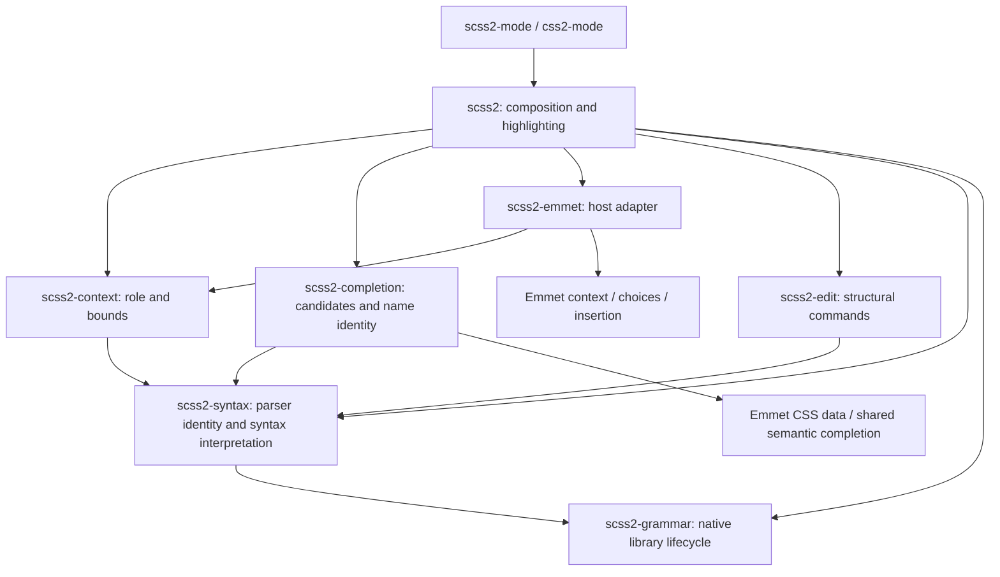

# Architecture

The document is an Emacs buffer. Tree-sitter, lexical syntax, completion and
structural targets are readings of that buffer, not independently synchronized
models. The only persistent derived artifact is a native parser library keyed by
the bundled snapshot and platform.

## Dependencies and responsibilities



| Library | Responsibility and interface | State / excluded dependencies |
| --- | --- | --- |
| `scss2-grammar` | `scss2-grammar-ensure` loads a private dialect identity; compilation and disk cache | Owns content/platform identity, native artifacts and per-session load verification; no editor feature dependencies |
| `scss2-syntax` | `scss2-syntax-setup` initializes the parser and lexical properties; shared node/identity/range readers | Owns buffer dialect, loaded language and session-compiled internal queries; no completion, editing, host or Emmet dependency |
| `scss2-context` | `scss2-context-at-point` returns role, bounds and role-specific facts | Request-local reads only; no catalog, module I/O, host or Emmet dependency |
| `scss2-completion` | `scss2-completion-for-context` consumes explicit context plus the current parsed buffer; supplies candidates and name identity to `emmet2-completion-capf` | Tables are session-local; no classifier, host mode or Emmet adapter dependency |
| `scss2-edit` | Public structural commands and syntax-based TAB navigation | Targets live for one command; no context, completion or required frontend dependency |
| `scss2-emmet` | Context provider, explicit expansion and abbreviation CAPF; requests host field navigation | One synchronous context binding; external Emmet owns live choices, revisions and insertion |
| `scss2` | `scss2-completion-at-point` selects the provider; mode setup, font lock and navigation | Composition owns hook registration; semantic libraries never call back into it |

Root Lisp files are Emacs load-path libraries. Their separation follows these
responsibilities; a directory hierarchy or another runtime wrapper layer would
not create a stronger boundary. `vendor/` is an indivisible generated snapshot;
`scripts/` contains build/test/measurement entry points; `test/` contains subsystem
contracts and full-mode integration. There are no runtime dependencies on `test/`
or `docs/`.

The documented commands, major modes, `scss2-completion-at-point` autoload and
completion category remain stable. Lower-level development uses the explicit
interfaces above; private `--` helpers are owned by their library.

## Initialization and lifetime

1. Enter the built-in `css-mode` or `scss-mode` base, retaining its indentation and
   comment behavior. Emacs clears the previous major mode's local state/parsers.
2. `scss2-syntax-setup` selects the dialect and private grammar generation, creates
   its parser with a change notifier (see
   [Changed ranges of early reparses](#changed-ranges-of-early-reparses)) and
   installs the shared syntax-property reader.
3. Full mode composition adds Emmet, highlighting, navigation and the CAPF hook,
   then makes treesit.el's tree hooks and commands read Font Lock's view (see
   [Narrowing and the shared parser](#narrowing-and-the-shared-parser)).
   A syntax-only client can stop after step 2.

Like built-in tree-sitter modes, full mode composition checks
`treesit-max-buffer-size` before step 2: a larger buffer skips steps 2-3 and
keeps its base mode with the standard `treesit` warning. `scss2-syntax-setup`
has no size check; syntax-only clients own that policy.

Keymaps are shared by every buffer of a mode, so buffer state must not be
written into them unconditionally. `treesit-major-mode-setup` does exactly that:
it remaps `beginning-of-defun` and `end-of-defun` in the mode map, and a larger
buffer opened before or after a parsed one would then run tree-sitter motion
without a parser, leaving point in place. `scss2--scope-tree-remaps` turns each
remap into a `menu-item` whose filter, `scss2--tree-binding`, returns the
command only where `treesit-primary-parser` is set. Only
`treesit-major-mode-setup` sets it, so oversized buffers and buffers whose setup
failed are excluded. Elsewhere the filter returns the parent keymaps' remap,
because a nil result would shadow remaps in `css-mode-map`, `scss-mode-map` or
`prog-mode-map`; a larger buffer keeps the base mode's `C-M-a` and `C-M-e`.
Help listings that render keymaps in a temporary buffer, such as `C-h m` and
`\{scss2-mode-map}`, therefore omit the scoped remaps; `C-h b` and `C-h f` in a
parsed buffer still show them. The remap scoping is INTERIM until treesit.el
stops writing the shared map (upstream report draft 10, in tree-sitter-scss
`plans/upstream-reports/`); it is separate from the narrowing wrappers and
outlives them. To check whether a newer Emacs still needs it, delete the
`scss2--scope-tree-remaps` call in a scratch copy:
`scss2-mode-oversized-buffers-keep-base-defun-motion` fails while
`treesit-major-mode-setup` still writes the remaps. If treesit.el stops
remapping instead, `scss2-mode-parsed-buffers-remap-defun-motion` must expect
`beginning-of-defun` and `end-of-defun`.

The shared query owns semantic capture roles; the host owns their faces.
Selector prefixes inherit the selector role. Full highlighting uses the standard
number face for numbers and nth formulas, and the type face for units.
Expression operators retain the value face.
Compact highlighting keeps the unit face while omitting numbers.
The `number` and `unit` nodes and their ranges remain separate in the parser,
independent of color, for syntax consumers and numeric editing.
Selectors and properties use the built-in `css-selector` and `css-property`
faces. The remaining roles use standard Font Lock faces, so themes own the
palette without a mode-specific color scheme or theme dependency.

The buffer's grammar identity stays fixed even if loading a newer package changes
the global snapshot identity. Features read that buffer identity. Compiled
internal queries are session data keyed by that immutable identity and the query
form; each native library path is verified to load once per session. Local
module completion reuses a matching parser in an open buffer, including unsaved
edits; otherwise it parses that authoritative text, or a disk file, in a
temporary buffer. Temporary parsers die with their buffers. There is no module
index.

`scss2-syntax` owns one idle timer that releases trees and fontification from
invisible buffers. It retains each parser's identity: an empty parse frees the
native tree, then restoring the original full-buffer range marks it for lazy
reparsing through every native consumer. No suspended-buffer registry or
feature-specific resume path is needed. Font Lock invalidation and
unfontification remove its managed properties; equal remaining property runs are
coalesced without removing syntax or third-party properties. Text, narrowing,
point, modification state and undo remain unchanged. The timer yields between
buffers when input is pending and stops when no syntax clients remain.

Visible buffers in all frames, active completion sessions, and indirect buffers
and their bases are excluded. Parsers with custom ranges, other packages'
notifiers, or additional parsers also remain untouched because they have other
lifecycle owners; the mode's own change notifier does not count. Cleanup does
not force GC; freed allocations can remain resident in Emacs's allocator.

## Completion flow

`scss2-context-at-point` first excludes opaque comments and strings, then applies
one ordered classifier. Recognized literals, names, selectors, queries and
declarations precede text recovery for unfinished statements. Order is language
behavior. A recovered tree shape decides a role only when it confirms that role.
Without auto-pairing an unclosed `(` is the ordinary typing state, and recovery
can attach the next statement's tokens to it, so the classifier reads the colon
after a declaration name from the text, accepts an unqualified `var(` first
argument from the text, defers an unclosed group in a query statement to the
`@media`/`@container`/`@supports` statement-text recovery, and treats a Sass
statement starting with `$` as a variable declaration even outside a block. The
result contains accessible replacement bounds, a role and only the
facts consumers need (`:property`, `:owner`, `:module`, `:mixin`, `:query`, `:start`).
No intermediate rule object or context cache is retained.

A declaration prefix followed by a blank line and a nested selector can be
parsed as one valid multiline selector. In a declaration body, completion treats
that isolated, unqualified token as an insertion slot. The same preference
applies when the token occupies a new line after a semicolon-terminated
declaration, even without an extra blank line before the nested rule. Comments
between statements do not change this decision. This is an editing preference
for ambiguous bare words, derived from sibling nodes rather than remembered
typing state or a property catalog. Explicit selector prefixes, pseudo chains
and leading combinators on the following line retain their selector role, as
do adjacent selector lines without that preceding declaration. The syntax tree
and highlighting are unchanged. A declaration prefix may contain bracket raw
values with blanks, such as `p[1px 2px]`, and Sass variables glued to the
abbreviation, such as `p$a$b$c`. A bracket group with `=` before any
string, call or nested bracket keeps the selector role (`a[title='x']`),
because attribute selectors put their operator first. Strings, calls and
nested brackets balance inside the group, so `=` or `]` there stays part of a
raw value, as in `bgi[url(a.png?x=1)]`, `ct[']']` or `gtc[repeat(2, [a] 1fr)]`.

Composition routes declaration prefixes to Emmet and other supported roles to
semantic completion. Semantic tables are exclusive: other completion functions
do not run in an owned context, even without a match. A module without a local
file (`sass:math`, packages, load paths) and an import path with a scheme or
without a local directory return nil instead, leaving them to later functions
such as a language server. Only resolving the module and checking its file is
eager: frontends such as Corfu call the dispatcher again on every key, so
members are collected on the first candidate query. Deciding that a local module
which only `@forward`s has no names would parse it on each key, so it stays
exclusive. Emmet's table keeps emmet2's own `:exclusive 'no`; every candidate is
the abbreviation itself, so it wins whenever it has choices and yields when an
admitted word has none. The adapter's dynamic context binding only avoids
analyzing the same synchronous request twice. It is never captured by a table;
future Emmet requests use current source and revision checks.

Semantic tables obey Emacs's literal completion-table protocol. The `scss2` style
uses Emmet2's shared matcher with the host's escape/Sass identity function,
leaving original insertion spellings intact. Function acceptance only places point
inside empty parentheses; no value completion creates snippet fields. TAB uses
the current parsed declaration to jump directly past its semicolon, including
from nested calls and snippet fields. Other snippet navigation keys retain their
own behavior; outside accessible, complete values, TAB retains its existing
binding. Common annotation text is
derived once per table; display callbacks read that same immutable table context.
Frontends own timing and drawing. Emmet owns
its own table, render options, preview, stale-candidate validation and atomic
insertion transaction. Emmet inserts CSS results without snippet fields, keeping
canonical results and initial cursor positions.

## Structural mutation and history

Commands derive a target from the current tree, validate its accessible range and
recovery boundary, then execute through `scss2--transaction`. Emacs's atomic change
group owns text history. The transaction also restores point, mark, activation and
kill-ring state when an operation signals an error or quit. No syntax node or
position is cached across edits. Clipboard callbacks are an external mutation
boundary and retain the existing source/point checks.

Completion tolerates unfinished code; that does not authorize destructive edits
through uncertain ranges. These policies have separate acceptance tests, including
an integration contract exercising both on the same unclosed callable.

## Invariants and independent tests

- One document authority: buffer text, with Emacs-owned undo and incremental parse.
- One buffer syntax identity; no second parser for highlighting or completion.
- Every scss2 tree reader reads Font Lock's view: the widened buffer unless
  `font-lock-dont-widen` is set. That covers tree hooks, syntax properties,
  treesit.el commands, context, completion candidates, Emmet extraction and
  structural targets. Commands then act only inside the caller's restriction.
  Hooks that Emacs runs on its own read the tree only when the buffer has its
  own scss2 parser; otherwise, as in a `clone-indirect-buffer` clone, they keep
  the base mode's behavior.
- Every reparse after a text change marks the ranges it changed for
  refontification and extends the next syntax propertization back to them
  within that caller's restriction, whichever reader caused it; idle release's
  own reparses mark nothing.
- One completion dispatcher; lower libraries cannot load host composition.
- Context does not enumerate candidates or resolve module files.
- Semantic tables do not classify point or call the abbreviation adapter.
- Open-buffer module text wins over disk; loaded grammar generation is preserved.
- Targets and context are transient; no workers or synchronization. The only
  session caches are compiled internal queries and verified library paths.

```sh
make test-core
SCSS2_EMMET2_DIR=/path/to/emmet2-mode make test-semantic
SCSS2_EMMET2_DIR=/path/to/emmet2-mode make check
```

`test-core` runs grammar, context and structural editing with real parsers in a
fresh Emacs process, without an Emmet load path. `test-semantic` needs only Emmet's
data/matching libraries. The runner rejects indirect loads of forbidden higher
layers, so independence is a tested boundary. The shared test fixture initializes
real syntax rather than mocking tree nodes or the context API.

`make check` also keeps strict byte compilation, Python packaging/import tests,
the complete source ERT suite and isolated package-installation ERT. Full-mode
tests retain navigation, faces, hooks, dialect lifecycle, Emmet and cross-feature
contracts. The optional Corfu/YAS suite exercises typing, choosing, host TAB and undo;
it stubs drawing and is not GUI acceptance.

## Performance model

Tree-sitter owns incremental parsing. Classification traverses relevant ancestors
and current-statement text, and large sibling groups may require linear scans.
Definition enumeration is proportional to tree size plus scope checks. Module
exports and matching must inspect the offered symbol set; no O(1) large-project
claim is made. Path completion lists one local directory per request. Module
completion resolves the namespace's `@use` and checks that its file exists on
every request; that reads every `@use` in the tree, about 1.4 ms more per key on
the 73 KB fixture and 17 ms on its 729 KB repetition (byte-compiled, batch). It
enumerates and parses the module only when its members are queried.

Highlighter rules are built during mode setup. JIT invalidation and fontification
remain Emacs-owned. Existing batch workloads cover 0/1,000 declarations, open
modules with 100/1,000/5,000 symbols, a 73 KB fixture and its 729 KB repetition,
512 nested query levels, 4,096 query comments and a numbers-heavy document.

Grammar library verification and internal query compilation load the native
language, so they run once per session rather than per buffer. Emmet's CSS
documentation data loads on the first semantic completion that needs it.

Compare byte-compiled copies with the same parser, Emmet, inputs and GC
settings. Candidate counts, parser counts and face hashes must agree before
timing is compared. A repeatable material regression requires investigation; a
cache is not the default remedy.

## Narrowing and the shared parser

Emacs tree-sitter parsers follow narrowing. Any read of the tree inside a
restriction (`treesit-buffer-root-node`, `treesit-node-at`,
`treesit-parser-changed-regions`) first moves the parser to the accessible text;
the next read in the widened buffer must reparse everything outside it again.
Font Lock widens before fontifying unless `font-lock-dont-widen` is set, so a
reader that uses another view than Font Lock flips the parser between the two.

The symptom is keystroke cost proportional to the buffer size, only while the
buffer is narrowed. Commands that narrow internally, such as `uncomment-region`,
`comment-dwim` (`M-;`) and comment toggles like evil-nerd-commenter, cause the
same cost in a widened buffer. In Emacs 31.1 two treesit.el hooks read inside
the restriction on every change, so each edit paid a restricted parse and then
a near-full reparse. Batch measurements of byte-compiled copies with an emulated
command loop and redisplay:

| Case | Stock hooks | Widened hooks |
| --- | --- | --- |
| 729 KB stylesheet narrowed to 5.7 KB, per key | 57-59 ms, 2 parses | 3.5-4.0 ms, 1 parse |
| The same buffer widened, per key | 3.5-3.7 ms | 3.5-3.7 ms |
| `uncomment-region` of one line, widened 729 KB buffer | 54-57 ms | 3.6-4.1 ms |
| 27 KB stylesheet narrowed to 2.5 KB, per key | 4.2-4.3 ms | 0.20-0.21 ms |

scss2 therefore replaces two private treesit.el functions that
`treesit-major-mode-setup` adds to buffer-local hooks:

| Hook | treesit.el function | scss2 wrapper |
| --- | --- | --- |
| `pre-redisplay-functions` | `treesit--pre-redisplay` | `scss2--pre-redisplay` |
| `syntax-propertize-extend-region-functions` | `treesit--pre-syntax-ppss` | `scss2--pre-syntax-ppss` |

`scss2--setup` in `scss2.el` calls `scss2--widen-tree-hooks` right after
`treesit-major-mode-setup`. For each pair in `scss2--widened-tree-hooks` it
removes the treesit.el function from the buffer-local hook and adds the wrapper
at depth 0, where treesit.el added it. Each wrapper calls the treesit.el
function inside `scss2--with-font-lock-view` (`scss2-syntax.el`): a
`save-restriction` that widens unless `font-lock-dont-widen` is set. Redisplay
rechecks the restriction after these hooks, so restoring it unchanged costs no
redisplay optimization.

Some hosts fontify only the restriction. Polymode sets `font-lock-dont-widen` in
its buffers, and markdown-ts-mode binds it while fontifying a code block in an
indirect buffer narrowed to the block. There the restriction is the document,
so the wrappers read inside it, as the stock hooks and Font Lock do. Widening
would parse the host text as stylesheet code on each change, and host text such
as `/*` before the restriction could turn the stylesheet into a comment.

`treesit--pre-syntax-ppss` can extend the propertized region back to the first
position the last reparse changed. In the full tree that position can precede
the caller's restriction, for example after closing a comment opened above it.
`syntax-propertize` would then clear properties from there and signal
`args-out-of-range`. `scss2--pre-syntax-ppss` clamps the start to the caller's
`point-min`, the bound the stock function applies inside a restriction; text
before the restriction keeps its previous syntax properties, as with the stock
hook.

`scss2--syntax-propertize` also queries the tree in Font Lock's view, so syntax
properties come from the parse that Font Lock uses. So do the package's other
tree readers: context, completion candidates, Emmet's abbreviation extraction
and structural commands, including the token and whole-line checks when
`scss2-kill` deletes a comment, resolve in Font Lock's view and then enforce the
accessible range. In a `font-lock-dont-widen` host the restriction is the
document, so completion and commands parse only the restriction, as redisplay
does, and host text is never parsed as stylesheet code. Imenu and idle release
widen before reading; local module completion reads other buffers widened.

If either treesit.el function is undefined or missing from its hook,
`scss2--widen-tree-hooks` leaves that hook unchanged. Editing then keeps Emacs's
stock behavior, and only the narrowed keystroke cost returns. Strict byte
compilation in `make check` reports a removed function as not known to be
defined.

### Tree-sitter commands

`treesit-major-mode-setup` also points public variables and mode-map remaps at
treesit.el commands that read the tree inside the caller's restriction. In a
narrowed buffer each invocation then costs a restricted parse plus a full
reparse at the next widened read, and the restricted parse can be wrong: a
restriction inside a block parses as top-level declarations, so `M-q` reports
"No defun detected at point". Right after setup, `scss2--widen-tree-commands`
points every variable and remap that still holds its treesit.el original at a
wrapper in `scss2.el`:

| Variable or remap | Used by | treesit.el function | scss2 wrapper |
| --- | --- | --- | --- |
| `<remap> <beginning-of-defun>`, `beginning-of-defun-function` | `C-M-a`, `beginning-of-defun` | `treesit-beginning-of-defun` | `scss2--beginning-of-defun` |
| `<remap> <end-of-defun>`, `end-of-defun-function` | `C-M-e`, `end-of-defun`, `mark-defun` | `treesit-end-of-defun` | `scss2--end-of-defun` |
| `prog-fill-reindent-defun-function` | `M-q` | `treesit-fill-reindent-defun` | `scss2--fill-reindent-defun` |
| `transpose-sexps-function` | `C-M-t` | `treesit-transpose-sexps` | `scss2--transpose-sexps` |
| `add-log-current-defun-function` | `which-function-mode`, `C-x 4 a` | `treesit-add-log-current-defun` | `scss2--add-log-current-defun` |
| `outline-search-function`, `outline-level` | `outline-minor-mode` | `treesit-outline-search`, `treesit-outline-level` | `scss2--outline-search`, `scss2--outline-level` |

Each wrapper finds its target in Font Lock's view, like the hooks above, and
then acts only inside the caller's restriction:

- `C-M-a`, `C-M-e` and `beginning-of-defun` move as in the widened buffer when
  the target is accessible. Otherwise point stops at the restriction's nearer
  edge and the function returns nil, as regexp-based defun motion does at a
  restriction edge. lisp.el's `end-of-defun` and `mark-defun` (`C-M-h`, not
  remapped) start with `beginning-of-defun-raw`, so when the defun around point
  begins before the restriction they work from the restriction edge and can
  move to or mark the following defun, as with regexp-based defun motion and
  the treesit.el commands.
- `M-q` chooses between filling and reindenting in Font Lock's view, with
  prog-mode's private `prog--text-at-point-p`, the predicate that
  `treesit-fill-reindent-defun` uses. A restriction that starts inside a
  comment hides the comment's opener: an apostrophe after it then reads as a
  string over the code below, and the stock command filled that code into the
  comment line. Filling runs through `treesit-fill-reindent-defun` inside the
  restriction only when the restriction reads the same comment or string;
  otherwise `M-q` signals a user error. Reindenting takes the innermost defun
  from the full tree and reindents its lines whose indentation is accessible.
  `indent-region` widens to compute indentation, so an accessible line gets the
  indentation the widened buffer gives it with the current text outside the
  restriction. A line that begins before the restriction or whose indentation
  crosses its end keeps its indentation.
- `transpose-sexps` takes both sexps from the full tree and signals a user error
  without editing when either extends outside the restriction.
- `add-log-current-defun` and `outline-level` only read the tree and return the
  full tree's answer.
- Outline search finds headings in the full tree but accepts only a heading line
  that begins inside the restriction. Otherwise it fails like a regexp search,
  stopping at the edge when asked to move.

Imenu needs no wrapper: `imenu--make-index-alist` widens before reading. With
an accessible target, results equal the widened buffer's, except for lisp.el's
`end-of-defun` and `mark-defun` as described above; without narrowing they
equal the treesit.el commands'. On a real 19 KB stylesheet narrowed to 30
lines around each sampled line, stock `M-q` reported "No defun detected at
point" for 31 of 104 restrictions and the wrappers for none whose restriction
contains point. Measured with the batch harness described above, per
invocation including the redisplay that follows:

| Case | treesit.el commands | Wrappers |
| --- | --- | --- |
| `C-M-a`, 729 KB stylesheet narrowed to 5.7 KB | 58.8-60.6 ms, 2 parses | 0.19-0.21 ms, no parse |
| `M-q`, then the next key, same buffer | 12.9-13.9 ms + 48.7-50.7 ms | 0.51-0.53 ms + 3.7-4.7 ms |
| `add-log-current-defun`, same buffer | 11.0-12.0 ms, 1 parse | 0.03-0.04 ms, no parse |
| `C-M-a`, 27 KB stylesheet narrowed to 2.5 KB | 0.94-0.99 ms, 1 parse | 0.06-0.07 ms, no parse |
| `M-q`, then the next key, same buffer | 1.28-1.37 ms + 3.71-3.92 ms | 0.18-0.20 ms + 0.25-0.32 ms |

Widened, the wrappers and the treesit.el commands cost the same. A variable or
remap that no longer holds its treesit.el original, because treesit.el or
another package changed it, stays unchanged and keeps that behavior. Strict
byte compilation reports a removed treesit.el command or
`prog--text-at-point-p` as not known to be defined.

### Tests and diagnosis

`test/scss2-narrowing-test.el` guards this behavior:

- `scss2-narrowing-typing-parses-once-per-key`: typing in a narrowed buffer, in
  both hook orders, parses once per key and never while narrowed; faces and
  syntax properties then equal a new unnarrowed buffer's.
- `scss2-narrowing-font-lock-dont-widen-reads-the-restriction`: with
  `font-lock-dont-widen`, typing parses only the restriction, once per key, and
  a narrowed code block after host text containing `/*`, an apostrophe or plain
  markup gets one restricted parse, the block's own syntax properties and
  context, and `scss2-mark` and `scss2-kill` targets inside it.
- `scss2-narrowing-comment-kill-at-the-edge-keeps-tokens-apart`: `scss2-kill`
  of a comment at a restriction's start or end keeps the value tokens around it
  apart.
- `scss2-narrowing-comment-commands-never-parse-the-restriction`:
  `comment-region` and `uncomment-region` in narrowed and widened buffers.
- `scss2-narrowing-features-read-the-full-tree`: context, completion,
  `scss2-mark`, `scss2-kill` of a comment and Imenu.
- `scss2-narrowing-syntax-extension-stays-accessible`: the clamp, also after an
  earlier reparse, without `syntax-propertize` complaining about the narrowing.
- `scss2-narrowing-wrappers-replace-only-present-treesit-hooks`: installation and
  the fallback for renamed or removed functions.
- `scss2-narrowing-tree-commands-match-the-widened-buffer`: at every line of
  nested SCSS, with restriction edges at line starts and inside lines, each
  command matches the widened buffer when its target is accessible, and
  otherwise stops at an edge or refuses without editing. Widened, it matches
  the treesit.el command.
- `scss2-narrowing-tree-commands-parse-once`: after an edit, each command and
  the redisplay that follows parse once, plus once more when the command itself
  edits text (as `transpose-sexps` does), never in the restriction.
- `scss2-narrowing-fill-reindent-defun-in-a-cut-block`: `M-q` in a restriction
  inside a block, including lines whose indentation begins before or crosses it.
- `scss2-narrowing-fill-reindent-defun-decides-in-the-full-buffer`: `M-q` below
  or inside a comment whose opener lies before the restriction.
- `scss2-narrowing-outline-search-finds-only-accessible-headings` and
  `scss2-narrowing-outline-level-reads-the-full-tree`.
- `scss2-narrowing-tree-command-wrappers-replace-only-treesit-originals`:
  installation and the fallback for changed variables.

To diagnose slow narrowed editing:

1. Run `SCSS2_EMMET2_DIR=/path/to/emmet2-mode SCSS2_TEST_SELECTOR=scss2-narrowing make test`.
2. In the slow buffer, evaluate
   `(list pre-redisplay-functions syntax-propertize-extend-region-functions)`.
   It must show the `scss2--` wrappers, not the `treesit--` functions. Otherwise
   check whether treesit.el still defines both functions and adds them in
   `treesit-major-mode-setup`, then update `scss2--widened-tree-hooks`. For a
   slow command, evaluate the variables in `scss2--widened-tree-functions`; each
   must hold its `scss2--` wrapper, or `scss2--widened-tree-functions` and
   `scss2--widened-tree-remaps` need updating.
3. Compare per-key time narrowed and widened, for example with
   `profiler-start`. To find a reader that parses the restriction, attach a
   notifier that records a backtrace for each narrowed parse, then remove it
   with `treesit-parser-remove-notifier`; idle release skips the buffer while a
   notifier is attached. Where `font-lock-dont-widen` is set, every parse is
   narrowed by design; look for widened parses there instead:

   ```elisp
   (defun my-scss2-narrowed-parse (_ranges parser)
     (with-current-buffer (treesit-parser-buffer parser)
       (when (buffer-narrowed-p)
         (let ((standard-output (get-buffer-create "*scss2 narrowed parses*")))
           (backtrace)))))
   (treesit-parser-add-notifier (car (treesit-parser-list)) #'my-scss2-narrowed-parse)
   ```

The root cause belongs upstream in treesit.el: its redisplay and
syntax-propertize hooks and its commands read the tree inside the caller's
restriction instead of Font Lock's view. Upstream report draft 01 (in
tree-sitter-scss, `plans/upstream-reports/`) covers the hooks; its open
question, whether parsers should follow narrowing at all, covers the commands'
tree reads. Draft 08 describes the long-line labeled restriction, which `widen`
cannot lift: tree-sitter Font Lock still reparses inside the label there, and
these wrappers do not help. The wrappers are therefore marked INTERIM in
`scss2.el`.

Draft 01 concerns tree reads only. `treesit-fill-reindent-defun` chooses
between filling and reindenting with `prog--text-at-point-p`, which calls
`syntax-ppss` in the caller's restriction before reading the tree. The `M-q`
decision therefore needs its own fix in prog-mode or treesit.el, and
`scss2--fill-reindent-defun` has its own INTERIM marker; no upstream report
exists for it yet. Its exit check is
`scss2-narrowing-fill-reindent-defun-decides-in-the-full-buffer`.

To check whether a newer Emacs still needs the hook wrappers, delete the
`scss2--widen-tree-hooks` call in a scratch copy and run the narrowing tests
from step 1. In Emacs 31.1 the typing, comment command, feature and command
parse tests fail, as does
`scss2-narrowing-wrappers-replace-only-present-treesit-hooks`. Once only that
installation test fails, remove the two wrappers, `scss2--widened-tree-hooks`,
`scss2--widen-tree-hooks` and that test. For the command wrappers, delete the
`scss2--widen-tree-commands` call instead; in Emacs 31.1 seven narrowing tests
fail. Once only
`scss2-narrowing-tree-command-wrappers-replace-only-treesit-originals` fails,
remove the wrappers, `scss2--widened-tree-functions`,
`scss2--widened-tree-remaps`, `scss2--widen-tree-commands` and that test, and
change the commands that `scss2-mode-parsed-buffers-remap-defun-motion` expects
to `treesit-beginning-of-defun` and `treesit-end-of-defun`.
Keep `scss2--scope-tree-remaps`: it then scopes treesit.el's own commands (see
[Initialization and lifetime](#initialization-and-lifetime)).

## Changed ranges of early reparses

`treesit_ensure_parsed` computes the ranges that each reparse changed and passes
them to the parser's notifiers, but `treesit-parser-changed-regions` returns
them only to the caller that triggered the reparse. In Emacs 31.1 only
`treesit--pre-redisplay` marks those ranges for Font Lock and syntax
propertization, and only when its own call reparses. When completion,
`treesit-inspect-mode` or other code reads the tree between an edit and
redisplay, nothing marks them. Text whose parse changed outside the edited line
then keeps stale faces, for example a `@mixin` name once its parameter list
becomes valid, or the rules after a block comment is closed. jit-lock's
contextual refontification starts at the edited line, so it cannot repair text
before it.

`scss2-syntax-setup` adds `scss2--mark-changed-ranges` as a notifier of its
parser. Major-mode re-entry creates a new parser, which gets the notifier
again, and `treesit-parser-add-notifier` ignores a duplicate. On every reparse
the notifier sets the `fontified` property of each changed range to nil, the
jit-lock protocol for text to refontify, and records the earliest changed
position in `scss2--changed-start`. `scss2--extend-to-changed-start`, in
`syntax-propertize-extend-region-functions`, reparses first, then extends the
next propertization back to that position within the caller's restriction.

The notifier does not flush `syntax-ppss`. It runs inside whichever reader
reparsed, usually in Font Lock's widened view, so it cannot see a user's
restriction. Flushing before the restriction made `syntax-propertize` report
"Cannot syntax-propertize ... because of narrowing!" in 15 of 400 random
narrowed edits. treesit.el's own `treesit--font-lock-mark-ranges-to-fontify` is
private and also updates embedded parsers' ranges, which the bug#78402 change
moved out of reparse time; scss2 has no embedded parsers.

When redisplay itself reparses, its marking and the notifier's cover the same
ranges. Neither adds a parse: every key parsed once, with and without a tree
read before redisplay. Per-key medians with and without the notifier overlapped
in every run: 3.47-4.08 ms and 3.48-4.09 ms in the widened 729 KB buffer,
0.20-0.22 ms and 0.20-0.21 ms in the 27 KB one. In 250 random edits with a tree
read before each redisplay, 23-37 left stale faces without the notifier and
none with it.

Idle release ignores the mode's own notifier when deciding eligibility; other
packages' notifiers still keep a buffer. The release's empty parse and the lazy
rebuild after it both report the whole buffer as changed although no text
changed. Release records the text modification tick in `scss2--released-tick`,
and the notifier skips reparses at that tick: release has removed the
fontification, and the syntax properties still describe the unchanged text.
Marking resumes with the first text change.

`scss2-highlighting-early-tree-reads-keep-other-lines-current` and
`scss2-highlighting-early-tree-reads-extend-syntax-propertization` guard the
faces, the parse count and the syntax extension;
`scss2-resources-change-marking-is-registered-once`,
`scss2-resources-release-reparses-mark-nothing` and
`scss2-resources-keeps-custom-parser-clients` guard registration and release.

The notifier is marked INTERIM in `scss2-syntax.el`. Upstream report draft 09
proposes accumulating the ranges until `treesit-parser-changed-regions` returns
them; the once-per-poll design of draft 04 would also fix this. To check a newer
Emacs, delete the notifier registration in `scss2-syntax-setup` in a scratch copy
and run `SCSS2_TEST_SELECTOR=early-tree-reads make test`; in Emacs 31.1 both
tests fail. Once they pass, remove the notifier, `scss2--extend-to-changed-start`,
`scss2--changed-start`, `scss2--released-tick`, the notifier exception in
release eligibility, the registration test, the notifier assertion in
`scss2-resources-keeps-custom-parser-clients` and
`scss2-resources-release-reparses-mark-nothing`.

## Decisions and known limits

The dialect parser cache, transactional guards, direct local module support and
specialized identifier semantics serve current contracts. Dispatch is explicit,
and the core and semantic suites run independently. Structural edits keep
tokens when deleting comments, also at a restriction's edge, protect the required
first CSS `var()` argument, keep CRLF when duplicating statements, stop
`scss2-zap` at the closer of the innermost delimited construct around point,
refuse to duplicate a raw custom-property value and treat an `@at-root` query as
its statement's header; completion finishes unfinished loop ranges, variable
values and loop bindings.

The grammar cache rejects empty or missing compiler output before publishing it
and rebuilds existing empty caches. Release packaging requires a clean parser
manifest. CI requires the repository variable `SCSS2_EMMET2_REVISION`, the full
SHA of a published compatible Emmet2 commit.

Company tests expose one dependency limit: Company's `exact` acceptance status
does not enter semantic function parentheses; Emmet2 acts only on `finished`
because Corfu's preview insertion also reports `exact`. Emmet declaration
choices, Orderless category matching and ordinary Company value selection work
in batch checks. Batch checks do not cover GUI drawing.

`clone-indirect-buffer` copies a buffer's local syntax hooks but not its parser.
`scss2--extend-to-changed-start` and `scss2--syntax-propertize` therefore read
the tree only when the buffer has its own scss2 parser. A clone keeps base-mode
syntax, indentation, comments and motion, and the faces it shares with its
base, without tree features; raw-text `//` is not corrected there. Re-running
the mode from `clone-indirect-buffer-hook` was rejected: in Emacs 31.1 a killed
indirect buffer's parser leaks into its base (upstream report draft 02, in
tree-sitter-scss `plans/upstream-reports/`), and a base with two parsers is
never idle-released.

For a new feature, first identify its owner and behavioral contract, then change
the owning subsystem and add acceptance coverage. Changes to syntax interpretation
shared by features belong in `scss2-syntax`; new candidate catalogs belong to
their existing data owner. Benchmark hot-path changes. Add state or another layer
only when it removes a demonstrated obligation that direct derivation cannot.
