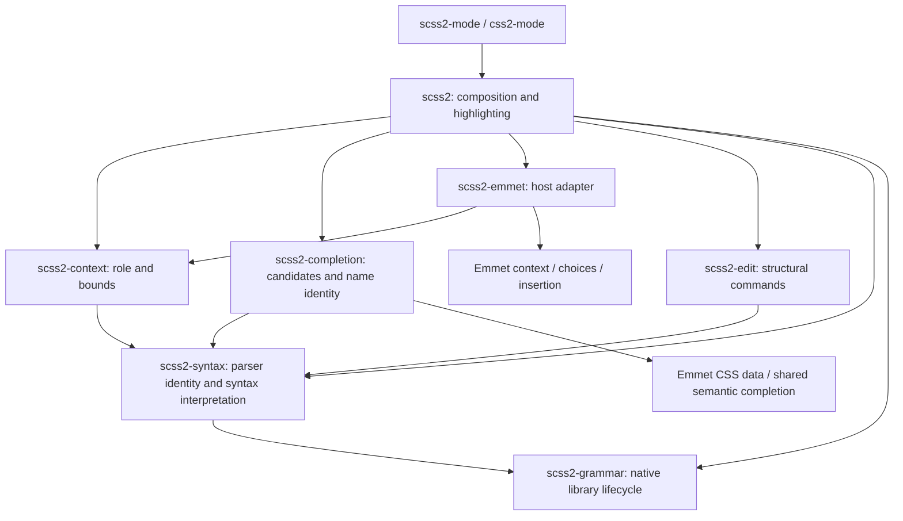

# Architecture

The document is an Emacs buffer. Tree-sitter, lexical syntax, completion and
structural targets are readings of that buffer, not independently synchronized
models. The only persistent derived artifact is a native parser library keyed by
the bundled snapshot and platform.

## Dependencies and responsibilities



| Library | Responsibility and interface | State / excluded dependencies |
| --- | --- | --- |
| `scss2-grammar` | `scss2-grammar-ensure` loads a private dialect identity; compilation and disk cache | Owns content/platform identity and native artifacts; no editor feature dependencies |
| `scss2-syntax` | `scss2-syntax-setup` initializes the parser and lexical properties; shared node/identity/range readers | Owns buffer dialect and loaded language; no completion, editing, host or Emmet dependency |
| `scss2-context` | `scss2-context-at-point` returns role, bounds and role-specific facts | Request-local reads only; no catalog, module I/O, host or Emmet dependency |
| `scss2-completion` | `scss2-completion-for-context` consumes explicit context plus the current parsed buffer; supplies candidates and name identity to `emmet2-completion-capf` | Tables are session-local; no classifier, host mode or Emmet adapter dependency |
| `scss2-edit` | Public structural commands and syntax-based TAB navigation | Targets live for one command; no context, completion or required frontend dependency |
| `scss2-emmet` | Context provider, explicit expansion and abbreviation CAPF; requests host field navigation | One synchronous context binding; external Emmet owns live choices, revisions and insertion |
| `scss2` | `scss2-completion-at-point` selects the provider; mode setup, font lock and navigation | Composition owns hook registration; semantic libraries never call back into it |

Root Lisp files are Emacs load-path libraries. Their separation follows these
responsibilities; a directory hierarchy or another runtime wrapper layer would
not create a stronger boundary. `vendor/` is an indivisible generated snapshot;
`scripts/` contains build/test/measurement entry points; `test/` contains subsystem
contracts and full-mode integration. There are no runtime dependencies on `test/`
or `docs/`.

The documented commands, major modes, `scss2-completion-at-point` autoload and
completion category remain stable. Lower-level development uses the explicit
interfaces above; private `--` helpers are owned by their library.

## Initialization and lifetime

1. Enter the built-in `css-mode` or `scss-mode` base, retaining its indentation and
   comment behavior. Emacs clears the previous major mode's local state/parsers.
2. `scss2-syntax-setup` selects the dialect and private grammar generation, creates
   its parser and installs the shared syntax-property reader.
3. Full mode composition adds Emmet, highlighting, navigation and the CAPF hook.
   A syntax-only client can stop after step 2.

The shared query owns semantic capture roles; the host owns their faces.
Selector prefixes inherit the selector role. Full highlighting uses the standard
number face for numbers and nth formulas, and the type face for units.
Expression operators retain the value face.
Compact highlighting keeps the unit face while omitting numbers.
The `number` and `unit` nodes and their ranges remain separate in the parser,
independent of color, for syntax consumers and numeric editing.
Selectors and properties use the built-in `css-selector` and `css-property`
faces. The remaining roles use standard Font Lock faces, so themes own the
palette without a mode-specific color scheme or theme dependency.

The buffer's grammar identity stays fixed even if loading a newer package changes
the global snapshot identity. Features read that buffer identity. Local module
completion reuses a matching parser in an open buffer, including unsaved edits;
otherwise it parses that authoritative text, or a disk file, in a temporary
buffer. Temporary parsers die with their buffers. There is no module index.

`scss2-syntax` owns one idle timer that releases trees and fontification from
invisible buffers. It retains each parser's identity and compiled queries: an
empty parse frees the native tree, then restoring the original full-buffer range
marks it for lazy reparsing through every native consumer. No suspended-buffer
registry or feature-specific resume path is needed. Font Lock invalidation and
unfontification remove its managed properties; equal remaining property runs are
coalesced without removing syntax or third-party properties. Text, narrowing,
point, modification state and undo remain unchanged. The timer yields between
buffers when input is pending and stops when no syntax clients remain.

Visible buffers in all frames, active completion sessions, and indirect buffers
and their bases are excluded. Parsers with custom ranges, notifiers, or additional
parsers also remain untouched because they have other lifecycle owners. Cleanup
does not force GC; freed allocations can remain resident in Emacs's allocator.

## Completion flow

`scss2-context-at-point` first excludes opaque comments and strings, then applies
one ordered classifier. Recognized literals, names, selectors, queries and
declarations precede text recovery for unfinished statements. Order is language
behavior. The result contains accessible replacement bounds, a role and only the
facts consumers need (`:property`, `:owner`, `:module`, `:mixin`, `:query`, `:start`).
No intermediate rule object or context cache is retained.

A declaration prefix followed by a blank line and a nested selector can be
parsed as one valid multiline selector. In a declaration body, completion treats
that isolated, unqualified token as an insertion slot. Adjacent selector lines,
explicit selector prefixes and pseudo chains retain their selector role; the
syntax tree and highlighting are unchanged.

Composition routes declaration prefixes to Emmet and other supported roles to
semantic completion. The adapter's dynamic context binding only avoids analyzing
the same synchronous request twice. It is never captured by a table; future
Emmet requests use current source and revision checks.

Semantic tables obey Emacs's literal completion-table protocol. The `scss2` style
uses Emmet2's shared matcher with the host's escape/Sass identity function,
leaving original insertion spellings intact. Function acceptance only places point
inside empty parentheses; no value completion creates snippet fields. TAB uses
the current parsed declaration to jump directly past its semicolon, including
from nested calls and snippet fields. Other snippet navigation keys retain their
own behavior; outside accessible, complete values, TAB retains its existing
binding. Common annotation text is
derived once per table; display callbacks read that same immutable table context.
Frontends own timing and drawing. Emmet owns
its own table, render options, preview, stale-candidate validation and atomic
insertion transaction. Emmet inserts CSS results without snippet fields, keeping
canonical results and initial cursor positions.

## Structural mutation and history

Commands derive a target from the current tree, validate its accessible range and
recovery boundary, then execute through `scss2--transaction`. Emacs's atomic change
group owns text history. The transaction also restores point, mark, activation and
kill-ring state when an operation signals an error or quit. No syntax node or
position is cached across edits. Clipboard callbacks are an external mutation
boundary and retain the existing source/point checks.

Completion tolerates unfinished code; that does not authorize destructive edits
through uncertain ranges. These policies have separate acceptance tests, including
an integration contract exercising both on the same unclosed callable.

## Invariants and independent tests

- One document authority: buffer text, with Emacs-owned undo and incremental parse.
- One buffer syntax identity; no second parser for highlighting or completion.
- One completion dispatcher; lower libraries cannot load host composition.
- Context does not enumerate candidates or resolve module files.
- Semantic tables do not classify point or call the abbreviation adapter.
- Open-buffer module text wins over disk; loaded grammar generation is preserved.
- Targets and context are transient; no new caches, workers or synchronization.

```sh
make test-core
SCSS2_EMMET2_DIR=/path/to/emmet2-mode make test-semantic
SCSS2_EMMET2_DIR=/path/to/emmet2-mode make check
```

`test-core` runs grammar, context and structural editing with real parsers in a
fresh Emacs process, without an Emmet load path. `test-semantic` needs only Emmet's
data/matching libraries. The runner rejects indirect loads of forbidden higher
layers, so independence is a tested boundary. The shared test fixture initializes
real syntax rather than mocking tree nodes or the context API.

`make check` also keeps strict byte compilation, Python packaging/import tests,
the complete source ERT suite and isolated package-installation ERT. Full-mode
tests retain navigation, faces, hooks, dialect lifecycle, Emmet and cross-feature
contracts. The optional Corfu/YAS suite exercises typing, choosing, host TAB and undo;
it stubs drawing and is not GUI acceptance.

## Performance model

Tree-sitter owns incremental parsing. Classification traverses relevant ancestors
and current-statement text, and large sibling groups may require linear scans.
Definition enumeration is proportional to tree size plus scope checks. Module
exports and matching must inspect the offered symbol set; no O(1) large-project
claim is made. File enumeration/temporary parsing occurs only for requested local
path/module completion.

Highlighter rules are built during mode setup. JIT invalidation and fontification
remain Emacs-owned. Existing batch workloads cover 0/1,000 declarations, open
modules with 100/1,000/5,000 symbols, a 73 KB fixture and its 729 KB repetition,
512 nested query levels, 4,096 query comments and a numbers-heavy document.

Compare byte-compiled copies with the same parser, Emmet, inputs and GC
settings. Candidate counts, parser counts and face hashes must agree before
timing is compared. A repeatable material regression requires investigation; a
cache is not the default remedy.

## Decisions and known limits

The dialect parser cache, transactional guards, direct local module support and
specialized identifier semantics serve current contracts. Dispatch is explicit,
and the core and semantic suites run independently. Structural edits keep
tokens when deleting comments, protect the required first CSS `var()` argument
and keep CRLF when duplicating statements; completion finishes unfinished loop
ranges, variable values and loop bindings.

The grammar cache rejects empty or missing compiler output before publishing it
and rebuilds existing empty caches. Release packaging requires a clean parser
manifest. CI requires the repository variable `SCSS2_EMMET2_REVISION`, the full
SHA of a published compatible Emmet2 commit.

Company tests expose two dependency defects: read-only discovery suppresses
Emmet candidates, and its `exact` acceptance status does not enter semantic
function parentheses. Orderless category matching and ordinary Company value
selection work in batch checks. Batch checks do not cover GUI drawing.

For a new feature, first identify its owner and behavioral contract, then change
the owning subsystem and add acceptance coverage. Changes to syntax interpretation
shared by features belong in `scss2-syntax`; new candidate catalogs belong to
their existing data owner. Benchmark hot-path changes. Add state or another layer
only when it removes a demonstrated obligation that direct derivation cannot.
